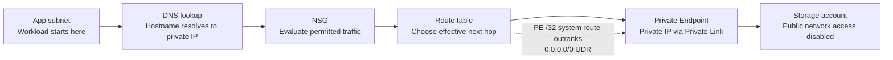

# Azure Network Path Audit

## Overview

This write-up documents a read-only investigation into why an application in Azure can reach a Storage account through a Private Endpoint even though the workload subnet has a user-defined default route pointing to a firewall appliance.

I traced the path across five configuration layers: the VNet and subnet, Network Security Group (NSG), route table, Private Endpoint, and private DNS. The findings below are based on the configuration inspected in the lab.

## The Ticket

> The application can reach the Storage account, but we do not understand why the connection works.
>
> The subnet has a route that sends outbound traffic through the firewall. Can you trace the path and explain whether Storage traffic is passing through the firewall?

## The Trace

### 1. The VNet

I checked the VNet's **Subnets** blade and identified the workload subnet, `snet-workload`, including its address range and attached network controls. The subnet is associated with an NSG and a route table.

This established where the workload starts and which security and routing configurations apply to its subnet.

### 2. The NSG

I reviewed the workload NSG's inbound rules. The custom rules included an HTTPS allow rule restricted to a specific source and a separate inbound deny rule, followed by Azure's default inbound rules. I also checked the subnet's NSG association.

NSGs filter traffic using rule priority, source, destination, port, protocol, and action. The inbound rules alone do not prove that outbound Storage traffic is permitted, so the outbound rules and effective path must also be considered.

### 3. The Route

I inspected the route table associated with the workload subnet. It contains a user-defined route for `0.0.0.0/0` with a virtual appliance as the next hop.

That default route sends otherwise-unmatched traffic toward the appliance. However, Azure selects routes using longest-prefix matching, so a more-specific route can take precedence over the default route.

### 4. The Private Endpoint

I reviewed the Private Endpoint's DNS configuration and confirmed that it has a private IP address associated with the Storage Blob endpoint. The lab configuration showed the endpoint connection as approved.

A Private Endpoint provides a private IP in the VNet for access to a supported PaaS service through Azure Private Link. The Storage account's public network access was disabled, so the intended access path was the approved private connection.

### 5. The Name

I inspected the `privatelink.blob.core.windows.net` private DNS zone and its A record. The record maps the Storage account's private-link hostname to the Private Endpoint's private IP address.

When the VNet is linked to the private DNS zone, the application can keep using the Storage account hostname while resolving it to the endpoint's private IP. DNS resolution determines the destination address; routing then determines which route applies to that address.

## The Answer to the App Team

The application requests the Storage account by hostname. The linked private DNS zone resolves the Storage private-link hostname to the Private Endpoint's private IP. The workload's NSG rules are evaluated, and Azure then selects the effective route for that destination. Although the subnet has a `0.0.0.0/0` user-defined route to a firewall appliance, the Private Endpoint's more-specific `/32` system route wins through longest-prefix matching. In this lab configuration, Storage-bound traffic therefore bypasses the firewall-directed default route and reaches Storage through Azure Private Link. The Storage account has public network access disabled, and the Private Endpoint connection is approved.

## What I Would Flag

The `/32` Private Endpoint route means the firewall appliance does not inspect this Storage-bound traffic in the observed configuration. I would confirm with the network team whether that bypass is intentional and whether the security design requires Storage traffic to pass through a firewall for inspection.

## Packet Path Diagram

**Note:** DNS lookup happens before the application sends traffic to the resolved destination; it is shown as the first logical step, not as a hop traversed by the data packet.

## Private Endpoint DNS Scenarios

| Scenario | DNS result | Expected path and outcome |
|---|---|---|
| Workload in the VNet with the private DNS zone linked | Private Endpoint IP | Private path through Azure Private Link; the approved private endpoint provides the intended access path. |
| Workload in the VNet without the private DNS zone linked | Public endpoint IP | Traffic follows the public-destination route toward the firewall; Storage rejects the request because public network access is disabled. |
| Laptop outside the VNet | Public endpoint IP | The laptop cannot use the VNet-linked private DNS zone and Storage rejects the public-endpoint request. |

The lab's packet-trace simulator illustrated these outcomes. DNS determines the destination IP; routing and the Storage account's network-access configuration determine the path and whether the service accepts the request.

## Key Takeaways

- NSGs filter traffic; route tables select the next hop.
- A `0.0.0.0/0` user-defined route is a catch-all, but a more-specific route can take precedence.
- A Private Endpoint provides private connectivity to a supported PaaS service.
- Private DNS must be linked and configured correctly for clients to resolve the hostname to the private IP.
- Creating a Private Endpoint does not, by itself, disable the service's public endpoint.
- Effective routes should be validated rather than assuming all traffic follows the firewall route.
- Read-only access can be enough to reconstruct a network path when the relevant configuration is available.

- Confirm that no lab flags or secrets are included.
- Verify every relative screenshot path in this README matches the uploaded file names.
